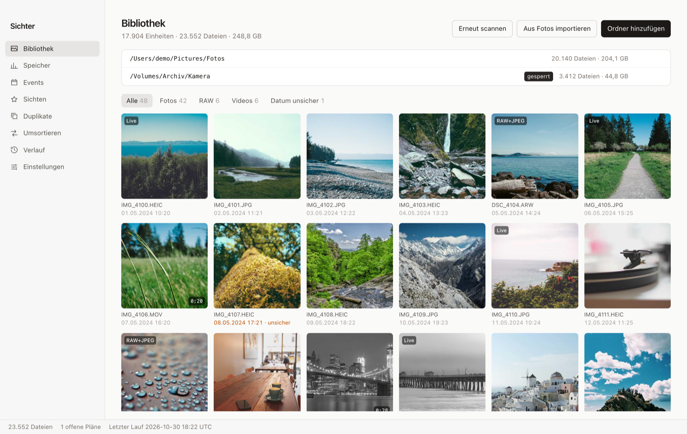
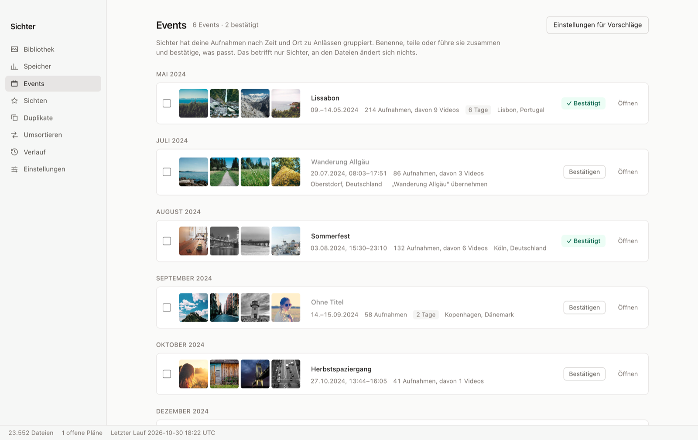
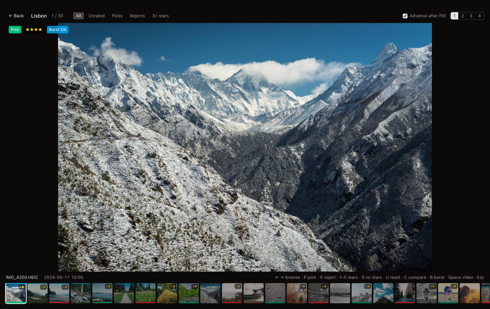
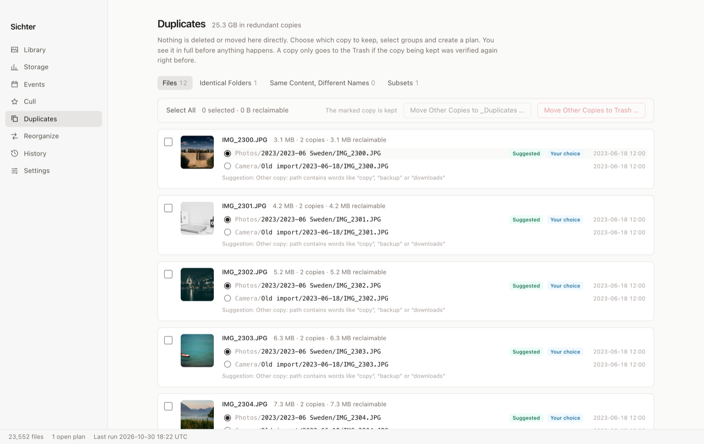
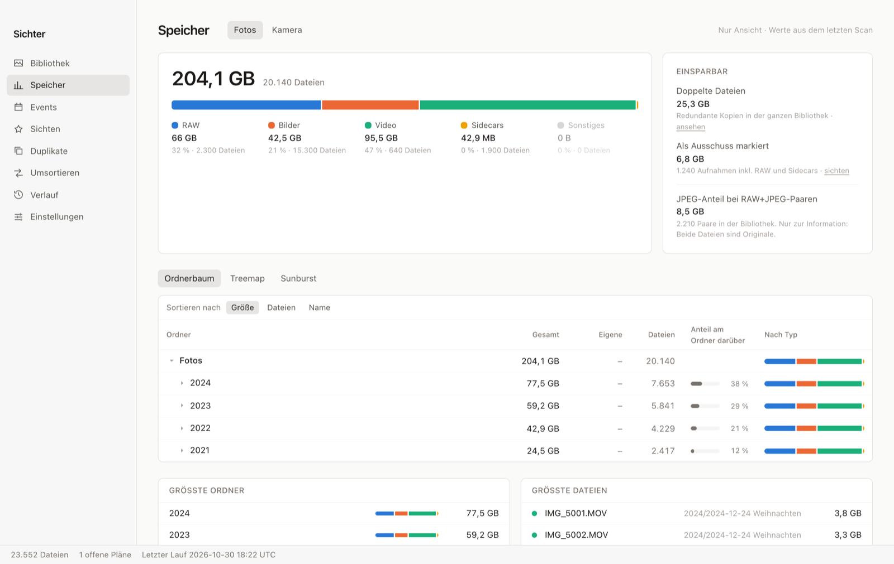
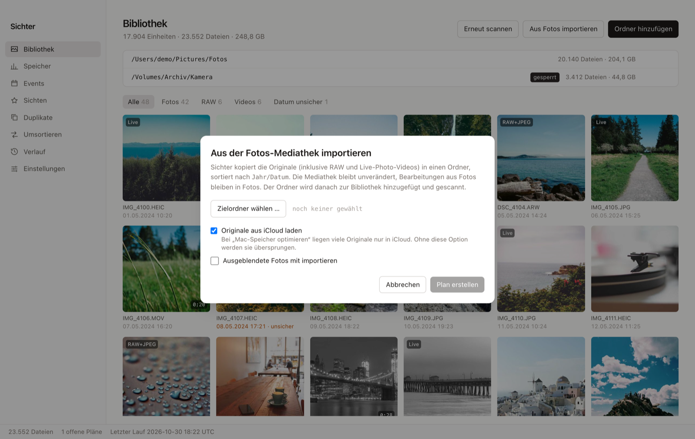
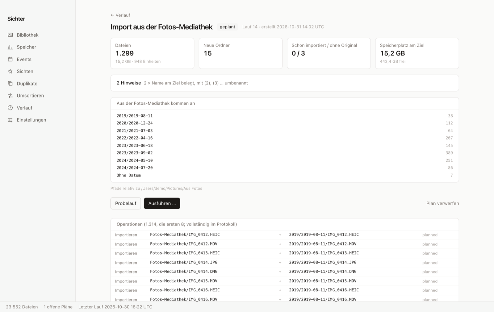

# Sichter

**Sort, cull and restructure large photo and video collections, without ever losing a file.**

Sichter is a desktop app for macOS (Windows in progress) built with Tauri 2, Rust and Vue 3. It indexes your existing folders read-only, groups photos into events, helps you cull them quickly, finds duplicates and then reorganizes everything into a clean folder structure such as `2024/2024-05-09 Lisbon/`.

Its one non-negotiable rule: **Sichter never deletes or changes anything on its own.** Every file operation is planned, shown to you, confirmed, journaled and can be undone.

> The user interface is currently in German. An English translation is planned.



## Features

- **Library scan:** JPEG, HEIC, PNG, TIFF, WebP, RAW (CR2, CR3, NEF, ARW, DNG, RAF, ORF, RW2) and video (MP4, MOV, M4V, AVI, MTS, 3GP, MKV). RAW+JPEG pairs, sidecars (`.xmp`, `.aae`, …) and Live Photos are treated as one unit. Incremental rescans, BLAKE3 hashes, thumbnails including embedded RAW previews and video frames.
- **Import from Apple Photos (macOS):** copies the originals from your Photos library, including RAW alternates and Live Photo videos, into a regular folder sorted by `Year/Date`. iCloud-only originals can be downloaded on the fly. The Photos library itself is never modified.
- **Events:** automatic grouping by time gaps and GPS distance, multi-day trips, offline place names (GeoNames). Rename, merge, split and confirm events.
- **Culling:** full-screen loupe with keyboard control (`P` keep, `X` reject, `1`–`5` stars), compare view for 2–4 images, burst detection, video playback.
- **Duplicates:** identical files, identical folders, folders with the same content under different names, and folders that are a subset of another (e.g. a half-finished copy).
- **Storage overview:** folder tree, treemap and sunburst with a breakdown by file type, plus how much space duplicates and rejects take up.
- **Reorganize:** template-based target paths (`{Year}/{Date} {Occasion}/{Original filename}`), move or copy, preview tree, dry run, conflict handling.
- **Optional XMP export** of ratings for Lightroom, Capture One or Bridge (off by default, merges existing sidecars).

| Events | Culling |
|---|---|
|  |  |
| **Duplicates** | **Storage** |
|  |  |

## Safety model

Sichter is built for collections you cannot afford to lose. These rules are enforced in code and covered by tests (details in [PLAN.md](PLAN.md), section 3):

1. **Read and write are separate.** Scanning, events, duplicate search and ratings never touch your files. Ratings live in Sichter's own database.
2. **Every change is a plan.** You see the full list of operations as a before/after tree before anything happens. Dry run is the default.
3. **Nothing is overwritten.** Name collisions get a ` (2)` suffix; identical files are reported as duplicates.
4. **Moves are verified.** Same volume: atomic no-replace rename. Across volumes: copy, verify the hash, only then remove the source.
5. **Deleting only means "move to Trash"**, only for files you explicitly approved, and duplicates only while a verified identical copy remains.
6. **Journal and undo.** Each operation is written to SQLite before and after it runs. Interrupted runs can be resumed; every run can be undone as a whole.
7. **Groups stay together.** RAW+JPEG, sidecars and Live Photo videos are always moved together.
8. **Locked folders** are never source or target of an operation.

All filesystem writes go through a single module (`src-tauri/src/fsops/`). A test fails the build if any other code calls a writing `std::fs` function.

## Importing from Apple Photos



In **Library → Aus Fotos importieren** you choose a target folder. Sichter then:

1. asks for access to your Photos library (macOS permission dialog, once),
2. reads the library through Apple's PhotoKit and plans one copy operation per original file,
3. shows the plan: target folders, number of files, required disk space,
4. after you confirm, exports the originals, dates each file to its capture time, and
5. adds the target folder to the library and scans it, so events, culling and reorganizing work as usual.



Details:

- **Originals only.** Edits you made in Photos stay in Photos. RAW+JPEG pairs and Live Photos keep a shared base name so Sichter recognizes them as one unit.
- **iCloud:** with "Optimize Mac Storage", many originals exist only in iCloud. With the "load originals from iCloud" option they are downloaded during the import; otherwise they are reported as failed and can be imported later.
- **Repeatable:** a second import only plans photos that have not been imported yet (tracked in the journal, not by file name).
- **Undo** moves the copies to the Trash. The originals in Photos are untouched either way.
- Hidden photos are skipped unless you opt in. Shared albums from other people are not imported.

If you denied access, enable it in **System Settings → Privacy & Security → Photos**.

## Installation

Download the latest `Sichter_x.y.z_universal.dmg` from [Releases](../../releases) (runs on Apple Silicon and Intel Macs, macOS 12 or later), open it and drag Sichter into *Applications*.

The app is not yet notarized by Apple, so macOS blocks it on the first launch:

1. Open Sichter once. macOS says it cannot be opened. Click *Done*.
2. Go to **System Settings → Privacy & Security**, scroll down and click **Open Anyway** next to the message about Sichter.
3. Confirm with your password. From then on Sichter starts normally.

Alternatively, in Terminal: `xattr -dr com.apple.quarantine /Applications/Sichter.app`

You can also build it yourself (see below).

## Development (macOS)

Requirements: Rust (stable), Node 22, pnpm, Xcode Command Line Tools, Perl (ships with macOS), and `brew install ffmpeg` (development placeholder only).

```sh
./scripts/fetch-sidecars.sh   # exiftool into src-tauri/resources/exiftool (SHA-256 checked),
                              # ffmpeg/ffprobe placeholders into src-tauri/binaries
pnpm install
pnpm tauri dev
```

Tests:

```sh
cargo test --manifest-path src-tauri/Cargo.toml
# Performance tests (10,000 files, 500 previews):
cargo test --release --manifest-path src-tauri/Cargo.toml --test perf -- --ignored --nocapture
# Tests that affect the system (RAM disk, real Trash). Run deliberately:
cargo test --manifest-path src-tauri/Cargo.toml --test runs real_ -- --ignored
cargo test --manifest-path src-tauri/Cargo.toml --test photos_import real_ -- --ignored
```

Tests never run against real photo folders. Fixtures are copied into temporary directories; the Photos import is tested against a fake library.

When running with `pnpm tauri dev`, macOS may attribute the Photos permission prompt to your terminal app instead of Sichter.

### Fixtures

`src-tauri/tests/fixtures/library` is generated with `scripts/make-fixtures.sh <Image-ExifTool-x/t/images>`. RAW files are metadata stubs from the ExifTool test suite; JPEG/HEIC/PNG/TIFF and videos are real, generated media.

## Sidecars

| Tool | Development | Release |
|---|---|---|
| exiftool | bundled Perl distribution (`resources/exiftool`), started via system Perl, with a watchdog against orphaned processes | macOS: same. Windows: `exiftool.exe` + `exiftool_files` |
| ffmpeg / ffprobe | Tauri sidecar `src-tauri/binaries/<tool>-<target>`, Homebrew placeholder (GPL, the app shows a warning) | macOS: `scripts/build-ffmpeg-lgpl.sh` builds LGPL 8.1.3 universal, static, system libraries only. Windows: LGPL build by BtbN via `scripts/fetch-sidecars.ps1` |

Override via environment variables: `SICHTER_EXIFTOOL`, `SICHTER_FFMPEG`, `SICHTER_FFPROBE`.

## Building a release

```sh
./scripts/build-ffmpeg-lgpl.sh                       # once, takes about 5–10 minutes
rustup target add aarch64-apple-darwin x86_64-apple-darwin
pnpm tauri build --target universal-apple-darwin     # .app and .dmg
```

**Signing and notarization** (requires an Apple Developer ID). Set before building:

```sh
export APPLE_SIGNING_IDENTITY="Developer ID Application: Name (TEAMID)"
export APPLE_ID="…" APPLE_PASSWORD="<app-specific password>" APPLE_TEAM_ID="TEAMID"
```

Tauri then signs the app and sidecars (hardened runtime with the Photos library entitlement, see `src-tauri/Entitlements.plist`) and submits it for notarization. In GitHub Actions, provide the same values as secrets. The `CI` workflow builds installers for macOS (universal) and Windows (NSIS, MSI) via "Run workflow → bundle".

**Windows:** `pwsh scripts/fetch-sidecars.ps1`, then `pnpm tauri build`. Windows tests run in the `windows-latest` CI job. The Photos import is macOS-only.

## Project structure

```
src/                 Vue 3 frontend (views, components, Pinia stores)
src-tauri/src/
  scan/ meta/ hash/  crawler, metadata (exiftool, ffprobe), BLAKE3
  thumbs/ video/     thumbnails, RAW previews, video frames
  events/ dupes/     clustering, place names, duplicate detection
  storage/           size aggregation
  photos/            Apple Photos access via PhotoKit (read-only)
  plan/              templates, plan generation, conflict handling, Photos import plan
  journal/           execution, undo, resume, logs
  fsops/             the only module that writes to disk
```

The roadmap and design decisions are in [PLAN.md](PLAN.md) (German), the change history in [CHANGELOG.md](CHANGELOG.md).

## Data sources and licenses

- [ExifTool](https://exiftool.org) by Phil Harvey (Perl Artistic License / GPL), bundled.
- [FFmpeg](https://ffmpeg.org) 8.1.3, bundled as an LGPL-2.1 build (`scripts/build-ffmpeg-lgpl.sh`).
- [GeoNames](https://www.geonames.org) `cities1000`, CC BY 4.0, for place names (`scripts/fetch-geonames.sh`, loaded by `fetch-sidecars.sh`).
- Screenshots use photos from [Unsplash](https://unsplash.com) via [Lorem Picsum](https://picsum.photos) and fictional demo data.
